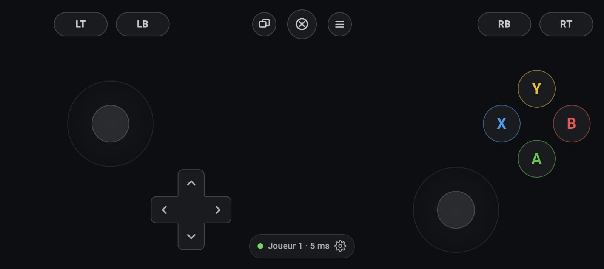

# Manette Pixel

*[English](README.md) · Français*

Ton téléphone devient une **manette Xbox 360** pour ton PC Windows ou Linux. Tu n'as rien à
installer sur le téléphone : il ouvre une page dans Chrome, et les jeux voient une vraie
manette Xbox.



- Joysticks, gâchettes, croix, A B X Y, bouton Xbox, et les vibrations du jeu sur le téléphone.
- Par **câble USB** (recommandé) ou par **Wi-Fi**.
- Jusqu'à **4 téléphones**, donc 4 joueurs.

---

## Ce qu'il te faut

- Un PC **Windows 10 ou 11**, ou **Linux** ([voir plus bas](#sous-linux)), connecté à
  Internet pour la première installation.
- Un téléphone **Android** avec Chrome. Un iPhone peut marcher en Wi-Fi, sans vibrations,
  mais ce n'est pas testé.
- Un **câble USB** qui transmet les données, pas un câble de charge seule. Un câble de
  chargeur rapide d'origine convient en général. Sans câble, il faut un **Wi-Fi** commun.

Python et le pilote de manette **s'installent tout seuls** s'ils manquent.

---

## Installation (une seule fois, 5 minutes)

### 1. Télécharger le projet

Sur la page GitHub du projet : bouton vert **Code → Download ZIP**.

Ensuite, **clic droit sur le .zip → Extraire tout… → Extraire**. C'est important : un
double-clic sur le .zip ne fait que regarder dedans, et rien ne marche depuis là. Range
le dossier extrait où tu veux, par exemple dans *Documents*.

### 2. Lancer `lancer.bat`

Double-clic sur **`lancer.bat`** dans le dossier extrait. Au premier lancement, plusieurs
fenêtres peuvent s'ouvrir, et c'est normal :

| Ce qui s'affiche | Ce qu'il faut faire |
|---|---|
| « Windows a protégé votre ordinateur » (fenêtre bleue) | **Informations complémentaires → Exécuter quand même**. Windows affiche ça pour tout script téléchargé. |
| Le terminal installe Python et les composants | Rien. Attends 1 à 2 min, il faut Internet. |
| L'installation de **ViGEmBus** (le pilote de manette virtuelle) | Coche *I accept*, clique sur **Install**, puis **Oui** quand Windows demande l'autorisation, et enfin **Finish**. |
| Le **Pare-feu Windows** demande s'il faut autoriser Python | Coche **les deux cases** (réseaux privés *et* publics), puis **Autoriser**. Sans ça, le Wi-Fi ne marchera pas. |

Si l'installation du pilote demande de redémarrer le PC, redémarre-le puis relance `lancer.bat`.

Quand le terminal affiche un QR code, **c'est prêt**. Garde cette fenêtre ouverte pendant
que tu joues : la fermer arrête la manette.

### 3. Préparer le téléphone pour le câble (recommandé)

À faire une seule fois. Ça permet à Chrome de joindre le PC par le câble.

1. *Paramètres → À propos du téléphone* : touche **7 fois** la ligne **Numéro de build**.
   Le téléphone te dit « Vous êtes maintenant développeur ». Sur un Samsung, la ligne est
   dans *Infos sur le logiciel*.
2. *Paramètres → Système → Options pour les développeurs* : active **Débogage USB**.

> Tu peux sauter cette étape si tu utilises seulement le Wi-Fi.

### Sous Linux

Les étapes 1 et 3 sont les mêmes. À l'étape 2, à la place de `lancer.bat`, lance dans un
terminal, depuis le dossier extrait :

```
./lancer.sh
```

S'il n'est pas exécutable, lance `bash lancer.sh`. Ce qui peut se passer :

| Ce qui s'affiche | Ce qu'il faut faire |
|---|---|
| « Il faut Python 3.10 ou plus, avec venv » ou « Il faut la bibliothèque libevdev » | Lance la commande affichée pour ta distribution (apt, dnf ou pacman), puis relance `./lancer.sh`. |
| « Une règle système est nécessaire… L'installer maintenant ? » | Réponds **O** et tape ton mot de passe. C'est à faire une seule fois : la règle permet à ton compte de créer la manette virtuelle (`/dev/uinput`) et de parler au téléphone en USB. |
| « Pas le droit de créer une manette virtuelle » | La règle est posée, mais ta session ne l'a pas encore prise en compte : déconnecte-toi puis reconnecte-toi. |

Les jeux, Steam et Proton voient une manette Xbox 360 standard, vibrations comprises.
La pastille affiche le numéro de manette au lieu du numéro de joueur, que Linux ne
transmet pas. Si tu utilises le pare-feu `ufw`, ouvre le port Wi-Fi avec
`sudo ufw allow 8765/tcp`.

---

## Jouer

### Par câble USB : le plus simple et le plus fiable

1. Lance **`lancer.bat`**.
2. Branche le téléphone au PC.
3. Au premier branchement, le téléphone demande **« Autoriser le débogage USB ? »**. Coche
   *Toujours autoriser sur cet ordinateur*, puis **Autoriser**.
4. **La manette s'ouvre toute seule** dans Chrome sur le téléphone. Touche **Jouer**.

Le câble marche sur n'importe quel réseau, même sans Wi-Fi, ou quand le téléphone partage
sa 4G/5G avec le PC. La latence est aussi la plus basse, et le téléphone se recharge
pendant la partie.

### Par Wi-Fi

1. Le PC et le téléphone doivent être sur **le même Wi-Fi**.
2. Lance **`lancer.bat`** : une page avec un QR code s'ouvre sur le PC.
3. Scanne le QR code avec l'**appareil photo** du téléphone, ouvre le lien, puis touche **Jouer**.

Le QR code contient l'adresse du PC sur le Wi-Fi (par exemple
`http://192.168.1.20:8765/?k=…`) et un code secret. Le code empêche les autres appareils
du Wi-Fi de prendre la manette. L'adresse `http://localhost:8765` ne marche **qu'avec le
câble** : sur le téléphone, « localhost » désigne le téléphone lui-même, et c'est le câble
qui le relie au PC.

### Lequel choisir ?

| Situation | Méthode |
|---|---|
| Wi-Fi de la maison, sans câble sous la main | Wi-Fi |
| Le téléphone partage sa connexion avec le PC | **Câble** (le Wi-Fi ne peut pas marcher) |
| Wi-Fi d'école, de résidence, d'hôtel, de café ou d'entreprise | **Câble** (ces réseaux isolent les appareils) |
| Tu veux la latence la plus basse | **Câble** |

---

## Les commandes

| Commande | Comment |
|---|---|
| Joysticks | Ils sont **flottants** : le centre se pose là où le pouce touche, dans la moitié du bas de l'écran pour le joystick droit. Si le pouce dépasse le bord, le centre le suit. |
| L3 / R3 (clic du joystick) | **Double-tape puis maintiens** le joystick. Le pommeau devient vert, et tu peux continuer à diriger pendant ce temps (par exemple pour sprinter). |
| Croix | Le pouce peut glisser d'une direction à l'autre, diagonales comprises, et déborder de la croix sans la lâcher. |
| A B X Y | Le pouce glisse d'un bouton à l'autre. Un appui **entre** deux boutons voisins presse les deux (désactivable). |
| LT LB / RB RT | Selon le **preset** choisi dans les réglages : **Normal** (gâchettes en haut, comme une vraie manette), **UFC 4** (voir plus bas), ou le tien. Glisser d'une gâchette à l'autre fonctionne aussi. |
| Pastille en bas | Elle affiche le n° de joueur et la latence. Un appui ouvre les **réglages** : taille, opacité, zone morte, course des joysticks, vibrations… |
| Boutons affichés | Dans les réglages, choisis **Xbox** (A B X Y, LB LT) ou **PlayStation** (✕ ○ □ △, L1 L2, croix en haut à gauche et les deux joysticks en bas). Le jeu voit toujours une manette Xbox. |

**Preset UFC 4.** Les gâchettes sont près des pouces, LT/RT au-dessus de LB/RB : le pouce pivote au lieu de s'étirer. Dans UFC 4, presque tout est un modificateur tenu plus un coup : LB + X fait un crochet, LT + X une amenée au sol, RB + X un clinch. Un seul pouce ne peut pas tenir RB et appuyer sur X en même temps. Ici, **une tape sur LB, RB ou LT l'arme** pour le coup suivant, et le bouton s'allume en vert. Tape LB puis X : le jeu reçoit LB + X. Une deuxième tape désarme, et tenir le bouton marche toujours normalement. Un bouton **LT+RT** en plus fait la garde basse et attrape une jambe d'un seul pouce.

**Tes propres presets.** La manette démarre sur **Normal**. Dans les réglages, ouvre la liste des presets et choisis **＋ Nouveau preset** (à partir de Normal ou d'UFC 4), ou touche **Personnaliser** sur le preset choisi : chaque bouton, les joysticks et la croix se glissent où tu veux. Le cadre en bas se déplace lui aussi par sa ligne du haut s'il gêne. Donne un nom, puis **Enregistrer** : le preset est gardé sur le téléphone et apparaît dans la liste. Il garde le comportement du preset de départ (parti d'UFC 4, il garde les modificateurs verrouillables). Réglages → **Supprimer** l'efface.

**Boutons combo.** En mode édition, touche **＋ Combo**, joue ton enchaînement sur la manette (par exemple jab, direct, puis LB et X pour un crochet), puis **Terminer**. Un bouton violet apparaît : place-le où tu veux, puis enregistre le preset. Une tape rejoue tout le combo avec ton rythme, à ×1, ×1,5 ou ×2. Il enregistre les boutons, les gâchettes, la croix et les modificateurs armés, pas les joysticks. Rien n'est envoyé au PC pendant l'enregistrement. En mode édition, la croix rouge sur un combo le supprime.
| Geste « retour » d'Android | Il met la partie en pause sans quitter la page. |

Le bouton Xbox du milieu ouvre aussi la **Game Bar** de Windows, comme une vraie manette.

---

## Dépannage

**Ça ne marche pas ? Cherche ce que tu vois.**

### En câble USB

**La manette ne s'ouvre pas sur le téléphone, et le terminal n'affiche pas « Téléphone branché en USB »**
- Le *Débogage USB* n'est pas activé (voir l'étape 3 de l'installation).
- Le câble ne fait que charger : essaie un autre câble ou un autre port USB.
- Déverrouille le téléphone et regarde si la question « Autoriser le débogage USB ? » attend.
  Si tu as refusé : *Options pour les développeurs → Révoquer les autorisations de débogage
  USB*, puis débranche et rebranche.
- Sur certaines marques, comme Samsung ou Xiaomi, Windows a besoin du pilote USB du
  fabricant : cherche « pilote USB *marque* ».

**Le terminal dit « Téléphone branché en USB », mais rien ne s'ouvre**
Ouvre toi-même **`http://localhost:8765`** dans Chrome sur le téléphone.

**« localhost a refusé de se connecter » (`ERR_CONNECTION_REFUSED`)**
Le téléphone ne passe pas par le câble. Soit le serveur n'est pas lancé (la fenêtre de
`lancer.bat` doit rester ouverte), soit le téléphone n'est pas relié : voir le premier point.

### En Wi-Fi

**« Site inaccessible », `ERR_ABORTED`, `ERR_TOO_MANY_RETRIES` ou une page qui charge sans fin**
1. Le téléphone et le PC sont-ils sur **le même** Wi-Fi ? Si le téléphone **partage sa
   connexion** avec le PC, Android envoie le trafic de Chrome par la 4G, et la page n'arrive
   jamais au PC. **Utilise le câble.**
2. **Pare-feu** : si tu n'as pas coché les deux cases au premier lancement, ouvre un
   PowerShell **en administrateur** (clic droit sur le menu Démarrer → *Terminal (admin)*),
   puis lance :
   ```
   New-NetFirewallRule -DisplayName "Manette Pixel" -Direction Inbound -Protocol TCP -LocalPort 8765 -Action Allow -Profile Private,Public
   ```
3. Le terminal liste parfois d'autres adresses du PC : essaie-les.
4. Wi-Fi public, d'école ou d'entreprise : ces réseaux bloquent les appareils entre eux,
   quoi que tu fasses. **Utilise le câble.**

**« Lien invalide »** : rescanne le QR code. `lancer.bat --nouveau-jeton` crée un nouveau
code secret et invalide les anciens liens.

### Côté PC et jeu

**Le jeu ne réagit pas**
- Win+R → **`joy.cpl`** → Entrée : « Controller (XBOX 360 For Windows) » doit apparaître.
  *Propriétés* montre les boutons qui s'allument quand tu touches le téléphone.
- Certains jeux ne voient une manette que si elle est branchée **avant** leur lancement :
  connecte le téléphone, puis relance le jeu.

**Un site de test de manette (comme gamepad-tester) affiche « aucune manette »**
Les navigateurs ne montrent une manette qu'**après un appui**, et seulement à la page affichée
au premier plan. Recharge la page (F5), clique dedans, puis appuie sur **A**. Le bouton Xbox
ne compte pas, car il ouvre la Game Bar par-dessus.

**Le terminal se ferme tout de suite ou affiche une erreur au lancement**
- *« Impossible d'écouter sur le port 8765 »* : le serveur tourne déjà dans une autre fenêtre.
  Ferme-la, ou lance `lancer.bat --port 8766`.
- *« Impossible de joindre le pilote ViGEmBus »* : installe-le à la main depuis
  [ViGEmBus releases](https://github.com/nefarius/ViGEmBus/releases), redémarre le PC, puis relance.
- *« Python n'a pas pu être installé »* : installe **Python 3.12** depuis
  [python.org](https://www.python.org/downloads/) en cochant **Add python.exe to PATH**.
- Dans tous les autres cas : supprime le dossier **`.venv`** (**`.venv-linux`** sous Linux)
  et relance `lancer.bat` (ou `./lancer.sh`).
  L'installation se refait proprement.

---

## Mettre à jour, désinstaller

- **Mettre à jour** : retélécharge le ZIP et remplace les fichiers. Tu peux garder
  `config.json` pour que tes liens Wi-Fi restent valides. `lancer.bat` réinstalle tout
  seul ce qui a changé.
- **Désinstaller** : supprime le dossier. Le pilote ViGEmBus se retire dans *Paramètres →
  Applications* (« ViGEm Bus Driver »). Si DS4Windows ou un autre outil de manette s'en
  sert, garde-le.

---

## Ce qui le rend fiable

- **État complet à chaque message**, jamais des « appui / relâche ». Un bouton ne peut pas
  rester coincé, car le message suivant corrige tout.
- **Chien de garde** : si le téléphone se tait plus d'une seconde (écran verrouillé, Wi-Fi
  coupé), la manette revient au neutre. Le personnage ne court pas tout seul dans un mur.
- **Reconnexion automatique**, sur la *même* manette virtuelle : le jeu ne voit pas de
  débranchement.
- Quand une fenêtre recouvre la manette (réglages, pause, téléphone tourné en portrait,
  application en arrière-plan), tout est relâché.
- Une manette dont le téléphone est parti depuis 2 minutes est débranchée de Windows : les
  manettes fantômes ne s'accumulent pas.
- Cliquer dans la fenêtre du serveur ne le fige pas (la sélection de la console Windows
  classique est désactivée).

```
Téléphone (Chrome) ──WebSocket, câble ou Wi-Fi──▶ serveur.py ──vgamepad──▶ ViGEmBus (Windows) / uinput (Linux) ──▶ le jeu
```

## Options

```
lancer.bat --port 8766          change le port (8765 par défaut)
lancer.bat --nouveau-jeton      invalide les liens et QR codes déjà donnés
lancer.bat --sans-navigateur    n'ouvre pas la page QR sur le PC
```

## Fichiers

- `lancer.bat` : installe ce qui manque (Python, dépendances), puis démarre le serveur.
- `lancer.sh` : l'équivalent sous Linux, qui pose aussi la règle udev.
- `serveur.py` : le serveur web et la manette virtuelle. Il installe aussi le pilote
  ViGEmBus et télécharge adb (outils officiels Google) au premier lancement.
- `web/` : l'interface du téléphone (`index.html`, `style.css`, `app.js`), sans dépendance.
- `config.json` : le code secret des liens Wi-Fi, créé au premier lancement.
