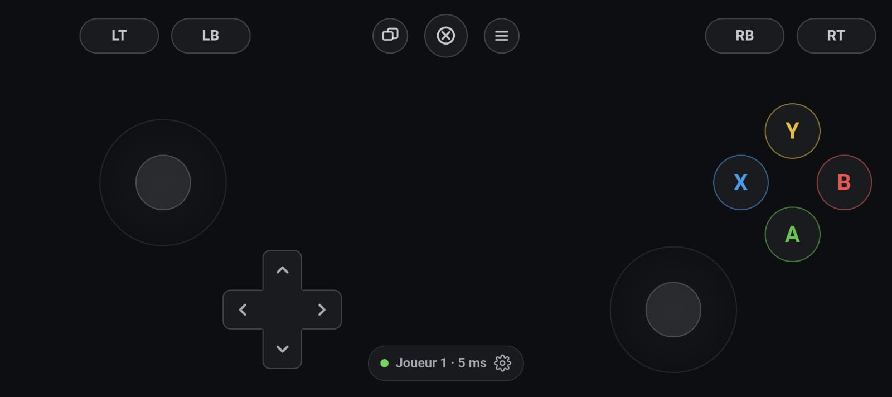

# Manette Pixel

*English · [Français](README.fr.md)*

Turn your phone into an **Xbox 360 controller** for your Windows or Linux PC. You don't
install anything on the phone: it opens a web page in Chrome, and games see a real Xbox
controller.



- Sticks, triggers, bumpers, D-pad, A B X Y, the Xbox button, and in-game rumble on the phone
- Over **USB cable** (recommended) or **Wi-Fi**
- Up to **4 phones**, so 4 players

## Requirements

- Windows 10 or 11, or Linux ([see below](#linux)), with internet access for the first setup
- An Android phone with Chrome. An iPhone may work over Wi-Fi without rumble; this is untested.
- A USB **data** cable, or a Wi-Fi network shared by the phone and the PC

Python and the controller driver are installed automatically if they're missing.

## Setup (once)

1. **Download**: *Code → Download ZIP*, then **right-click → Extract All**. It won't run
   from inside the zip.
2. **Run `lancer.bat`**. On the first run:
   - *Windows protected your PC*: click **More info → Run anyway**.
   - The **ViGEmBus** driver installer opens: accept, **Install**, **Yes**.
   - The **firewall** asks about Python: tick **both** private and public networks, then **Allow**.

   It's ready when a QR code appears. Keep that window open while you play.
3. **For the cable** (recommended): on the phone, tap *Settings → About phone → Build number*
   7 times. Then turn on *Settings → System → Developer options → **USB debugging***.

### Linux

Instead of `lancer.bat`, run `./lancer.sh`, or `bash lancer.sh` if it isn't executable.
- It needs **Python 3.10+ with venv** and **libevdev**. If either is missing, it prints the
  install command for your distro.
- On the first run, it offers to install a **udev rule** (sudo, once). The rule lets your
  account create the virtual controller (`/dev/uinput`) and talk to the phone over USB.
  If the controller is still refused, log out and back in.
- Games, Steam and Proton see a standard Xbox 360 pad, with rumble. The status pill shows
  the controller number instead of the player number, because Linux doesn't report it.
- With `ufw`, open the Wi-Fi port with `sudo ufw allow 8765/tcp`.

## Play

**USB cable.** Run `lancer.bat` and plug in the phone. Accept *Allow USB debugging*. The
controller **opens by itself** in Chrome on the phone. Tap **Play**. The cable works on any
network, even when the phone shares its mobile data with the PC, and it has the lowest
latency.

**Wi-Fi.** The phone and the PC must be on the same Wi-Fi. Run `lancer.bat` and scan the
QR code shown on the PC with the phone camera. The QR code holds the PC's Wi-Fi address and
a secret key. `http://localhost:8765` only works over the cable.

Use the **cable** when the phone is the PC's hotspot, or on school, hotel, office or public
Wi-Fi: these networks block devices from reaching each other.

## Controls

| | |
|---|---|
| Sticks | Floating: the centre is set where your thumb lands |
| L3 / R3 | Double-tap and hold the stick |
| D-pad, A B X Y | Slide your thumb between buttons. Pressing between two face buttons presses both. |
| Status pill | Shows the player number and latency. Tap it for settings: size, opacity, dead zone, rumble… |
| Android back gesture | Pauses the game; it doesn't leave the page |

## Troubleshooting

| Symptom | Fix |
|---|---|
| Cable: nothing opens on the phone | USB debugging is off, the cable is charge-only, or the *Allow USB debugging* prompt is waiting on the phone. Some brands (Samsung, Xiaomi…) need their USB driver. |
| `localhost refused to connect` | The `lancer.bat` window isn't running, or the phone isn't linked by cable |
| Wi-Fi: `ERR_ABORTED`, `ERR_TOO_MANY_RETRIES`, or the page loads forever | The devices aren't on the same Wi-Fi, the phone is the PC's hotspot, or the firewall blocks it. Use the cable, or open the port as admin: `New-NetFirewallRule -DisplayName "Manette Pixel" -Direction Inbound -Protocol TCP -LocalPort 8765 -Action Allow -Profile Private,Public` |
| *Invalid link* | Scan the QR code again |
| The game ignores the controller | Check that it shows up in `joy.cpl` (Win+R). Some games need the controller connected before they start. |
| A gamepad test site sees nothing | Reload the page, click inside it, then press **A**. The Xbox button opens Game Bar instead. |
| `Port 8765` in use | The server is already running: close the other window, or run `lancer.bat --port 8766` |
| Linux: *no permission* for `/dev/uinput` or the USB port | Run `./lancer.sh` again, accept the rule, then log out and back in |
| Any other setup error | Delete the `.venv` folder (`.venv-linux` on Linux) and run the launcher again |

## How it works

```
Phone (Chrome) ──WebSocket, cable or Wi-Fi──▶ serveur.py ──vgamepad──▶ ViGEmBus (Windows) / uinput (Linux) ──▶ game
```

- Every message carries the **full state**, so a lost message can't leave a button stuck.
- A **watchdog** resets the controller to neutral after one second of silence.
- The phone **reconnects to the same virtual controller**, so the game never sees it unplugged.
- Controllers left idle for 2 minutes are unplugged.
- Over USB, `adb reverse` forwards the phone's `localhost:8765` to the PC. adb is downloaded
  automatically.

Options: `--port 8766`, `--nouveau-jeton` (invalidates old links and QR codes),
`--sans-navigateur` (doesn't open the QR page on the PC).
